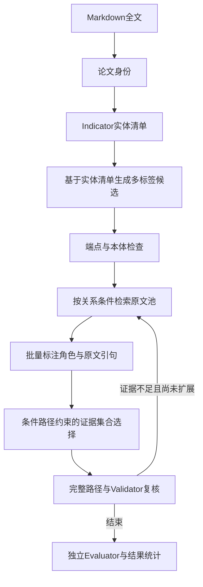

# ClimateKG

ClimateKG 是一个面向气候科学论文的本体引导知识图谱构建项目，论文成果发表于 AACL 2026。项目先从 ESGF 数据集元数据、CMIP6 受控词表、GCMD 关键词和 GeoNames 构建可信的图谱基础，再从科学论文中抽取实体、关系和证据，并经过本体检查、证据核验、LLM 验证和实体对齐后写入图谱。

本项目发布版本包含论文中的 2,000 篇论文：

| 指标 | 数量 |
| --- | ---: |
| KG 节点 | 133,990 |
| KG 关系 | 755,308 |
| 抽取候选三元组 | 39,964 |
| 验证后保留三元组 | 23,327（人工判断正确率 98.96%） |

## 项目结构

```text
extraction/            论文信息抽取与验证流程
  experiments/         论文实验、消融、召回率和基线比较脚本
kg_create/             图谱基础数据构建和 Neo4j 导入
  gcmd/ geolocation/   GCMD 关键词和 GeoNames 数据
  other_sources/       CMIP6 source_id 受控词表
  output/              本体 Turtle 文件和 CMIP6 模型组件
data/                  2,000 篇论文的发布数据（压缩文件）
scripts/unpack_data.sh 将发布数据解压到脚本所需目录
```

## 数据

| 文件 | 内容 |
| --- | --- |
| `data/kg/nodes_20260622.cypher.gz`、`edges_20260622.cypher.gz` | 可直接交给 `kg_create/upload_neo4j.py` 的 Cypher 创建语句 |
| `data/kg/nodes_20260622.json.gz`、`edges_20260622.json.gz` | JSON 格式的节点和边 |
| `data/pipeline_outputs/<stage>_<date>.tar.gz` | 各阶段的逐论文 JSON 输出 |
| `data/pipeline_outputs/entity_linked_papers_2000.json.gz` | 实体对齐结果，也是图谱构建的输入 |
| `data/papers/candidate_papers_<date>.json`、`paper_metadata_v2.json` | OpenAlex 论文元数据 |

语料分为两个批次：`2026-02-01`（1,007 篇）和 `2026-04-24`（993 篇）。各阶段输出是累积的，每个三元组会保留所有阶段的判定结果。

| 阶段 | 输出目录 | 添加字段 |
| --- | --- | --- |
| 三元组和证据抽取 | `extracted_papers` | — |
| 本体一致性检查 | `ontology_conformed_papers` | `ontology_conformed` |
| 证据核验 | `evidence_validated_papers` | `evidence_validated` |
| Validator Agent | `validated_papers` | `valid` |
| C_triplet 评估（仅用于评测） | `evaluated_papers` | `eval` |

完整 Cypher 文件包含 826,139 条边语句，其中 70,829 条引用了当前元数据快照中不存在的 ESGF `Source` 节点，Neo4j 加载时会跳过这些边，因此最终图谱包含约 755,000 条关系。发布包不包含论文 PDF、解析后的全文和人工标注的 1,000 条一致性评估三元组。

图谱也发布在 Hugging Face：`v1` 是本仓库的 2,000 篇论文版本，`v2` 是使用相同流程构建的 10,910 篇论文扩展版本。

```python
from datasets import load_dataset
nodes = load_dataset("aayushacharya/climatekg", "v1-nodes", split="train")
edges = load_dataset("aayushacharya/climatekg", "v1-edges", split="train")
```

解压发布数据：

```bash
./scripts/unpack_data.sh
```

## 环境配置

项目原始气候论文流程使用 Python 3.10：

```bash
conda create -n climatekg python=3.10
conda activate climatekg
pip install -r requirements.txt
cp extraction/.env.example extraction/.env
```

如果已经创建了 venv，直接激活已有环境并执行：

```bash
source .venv/bin/activate
python -m pip install -r requirements.txt
```

`.env` 中可配置 `GOOGLE_API_KEY`、`OPENAI_API_KEY`、`HF_TOKEN` 以及 Neo4j 连接信息。Neo4j 5 是图谱加载所需版本，默认地址为 `neo4j://localhost:8687`；也可以设置 `NEO4J_URI`、`NEO4J_USER` 和 `NEO4J_PASSWORD`。

## 将图谱加载到 Neo4j

`upload_neo4j.py` 会先删除目标数据库中的全部内容，再加载新的 Cypher 文件，因此只能连接空数据库或专门的重建数据库。

```bash
./scripts/unpack_data.sh
cd kg_create
python upload_neo4j.py --date 20260622
```

## 复现实验结果

阶段统计和消融结果直接读取已保存的阶段标志，不需要 API：

```bash
cd extraction
python experiments/stage_ablation.py
```

| 论文结果 | 脚本 |
| --- | --- |
| 阶段流失率和阶段消融 | `extraction/experiments/stage_ablation.py` |
| 分批次流水线统计 | `extraction/stats.py --date <date>` |
| CMIP 实体召回率 | `extraction/experiments/extract_cmip_publication_moreinfo_entities.py`、`evaluate_cmip_moreinfo_entity_extraction.py`、`analyze_cmip_missing_entities_in_parsed_papers.py`、`create_cmip_recall_report.py` |
| ClimateIE 比较 | `extraction/experiments/run_climateie_full_gemini_analysis.py` 及相关脚本 |
| KARMA 比较 | `extraction/experiments/karma/validate_1k_karma.py`、`analyze_1k_karma.py` |
| 证据位置和幻觉分析 | `extraction/experiments/evidence_section_analysis.py` |

部分基线实验需要额外数据，包括 ClimateIE 人工语料、KARMA 输出和解析后的论文全文。

## 原始气候论文流程

原始流程从 `extraction/` 目录运行。每个阶段读取前一阶段的 `output/<stage>/<date>/`，已经生成结果的论文会被跳过，因此中断后可以直接重启。

1. `find_papers.py` 通过 OpenAlex 查找候选论文，使用 Ollama 中的 Llama-3.3-70B 筛选并下载 PDF。
2. `parse_pdfs_olmocr.py` 使用 olmOCR 将 PDF 解析为 Markdown。
3. `extraction_agent.py` 使用 Gemini 抽取三元组、证据和论文级字段。
4. `ontology_conformance_agent.py` 检查实体类型、关系和方向是否符合 `consts.py` 中的本体。
5. `evidence_validation_agent.py` 将证据段落与解析后的论文文本进行模糊匹配。
6. `validation_agent.py` 使用 LLM 判断证据是否支持关系，默认模型为 Gemini-2.5-flash。
7. `evaluation_agent.py` 执行 C_triplet 评估，仅用于评测。
8. `create_embeddings.py` 使用 NV-Embed-v2 为图谱实体生成向量。
9. `entity_linking.py` 将抽取实体对齐到图谱节点，并对低置信度匹配使用 LLM 兜底。

随后在 `kg_create/` 中构建并加载图谱：

```bash
python download_esgf.py --help
python neo4j_v2.py
python upload_neo4j.py
```

## 科学计量论文：实体优先、候选优先的证据抽取

入口 `extraction/extract_md_deepseek.py` 读取已有 Markdown，使用项目 `.env` 中的 DeepSeek 配置。
实体类型是 Paper 和 Indicator；八种关系均独立多标签判定。

当前顺序为：

1. 抽取论文元数据，确定当前 Paper 身份。
2. 抽取 Indicator 实体清单。
3. 将全文、Paper 身份和实体清单交给关系候选请求，只生成端点与关系标签，尚不抽证据。
4. 独立抽取指标定义、公式和局限性；它们不作为关系证据的隐式来源。
5. 本体检查实体清单中的端点、类型和方向。
6. 根据每条候选关系的条件路径检索原文，批量标注可逐字定位的证据角色。
7. 程序按新增条件覆盖、文本成本和重复程度选择证据；完整覆盖一条路径后调用 Validator。
8. 不充分时只扩展一次检索池；最后独立调用 Evaluator，仅用于评测。



关系证据使用 `evidence` 数组，每个元素是一段原文及其定位信息：

```json
{
  "source_entity_instance": "A",
  "source_entity_type": "Indicator",
  "relation": "improves_on",
  "target_entity_instance": "B",
  "target_entity_type": "Indicator",
  "evidence": [
    {"id": "e0001", "text": "原文片段", "section": "Methods", "start": 100, "end": 104}
  ]
}
```

上述是字段示意；实际偏移必须与输入原文严格一致。新流程不输出关系 `paragraph` 字符串。
指标细节的 evidence 也为数组，其元素是各段原文字符串。旧字符串证据仅作为历史文件的读取兼容。

证明路径允许替代分支。例如 improves_on 可以由“明确指出A针对B的指定缺陷提出改进”支持，
也可由“直接来源于B＋B的指定缺陷＋A针对该缺陷的修复”联合支持；不能仅凭数值更高或相关性推断。
derived_from 还要求实质构造变化，不能把评价层级变更直接认作充分衍生证据。

运行：

```bash
.venv/bin/python extraction/extract_md_deepseek.py \
  --markdown "/路径/论文.md" --paper-id paper_001 --date 2026-11-03 \
  --output-root reports/my_condition_paths/pipeline
```

默认开启条件路径选择。`--no-relation-evidence` 使用同一候选/角色标注/Validator下的Top-k选择消融，
不再表示旧版“独立抽取关系与单个证据段落”的架构。`--evidence-rounds 0` 关闭唯一的一次缺口扩展，
默认1。单次选择最多6段、14000字符，首轮检索12个单元。

输出阶段目录仍为 extracted_papers、ontology_conformed_papers、evidence_validated_papers、
validated_papers、evaluated_papers。前两阶段的 evidence 可以为空数组；证据阶段才写入原文片段。
最终保留口径为 ontology_conformed、evidence_validated、valid 全为true。
Evaluator的eval不参与选择、补证或保留，只计算 C_triplet：保留结果中eval=true的比例。

代码分工：

- `evidence_index.py`：原文切分、偏移和稀疏检索。
- `evidence_selection.py`：关系证明路径、覆盖增益/成本/冗余的确定性选择算法。
- `relation_evidence.py`：角色标注、一次缺口反馈和最终Validator的简化流程。
- `evidence_schema.py`：证据数组格式、精确来源核验与历史兼容。

测试和新实验：

```bash
.venv/bin/python -m unittest discover -s extraction -p 'test*.py'
.venv/bin/python extraction/experiments/condition_paths.py fixed --workers 2
.venv/bin/python extraction/experiments/condition_paths.py calibration --workers 2
.venv/bin/python extraction/experiments/condition_paths.py fresh --workers 2
```

实验需要将已授权的五篇论文及证据发送至配置的DeepSeek服务。已完成请求按完整请求内容缓存，
代码变化后使用新的 `--output`；相同请求可以通过 `--cache-root` 复用，但不计为新的模型重复试验。
`fixed` 保留冻结局部基线，重做所有原拒绝项；`fresh` 将同一次新实体约束抽取的候选分别交给cover与Top-k。
Evaluator提示词与上轮报告逐字核对保持一致，不以其结果筛选关系。

最新方法定位与近期文献见 `reports/condition_paths_2026-11-03/research.md`。
实验记录见同目录报告；原始2026-11-02各版结果和代码快照保持不变。
旧实验脚本依赖旧版API，应使用其冻结代码复现，不能直接将旧字符串流程和当前数组流程混合比较。
当前评分是模型辅助的开发集结果，尚无专家金标准或独立留出测试集。

## 许可证

代码采用 MIT 许可证（`LICENSE`）。数据采用 CC BY 4.0（`DATA_LICENSE.md`）。

## 引用

```bibtex
@inproceedings{acharya2026climatekg,
  title     = {Ontology-Guided Knowledge Graph Construction from Structured Metadata and Climate Science Publications},
  author    = {Acharya, Aayush and Zhang, Qi and Dragut, Eduard and Latecki, Longin Jan},
  booktitle = {Proceedings of AACL 2026},
  year      = {2026}
}
```
