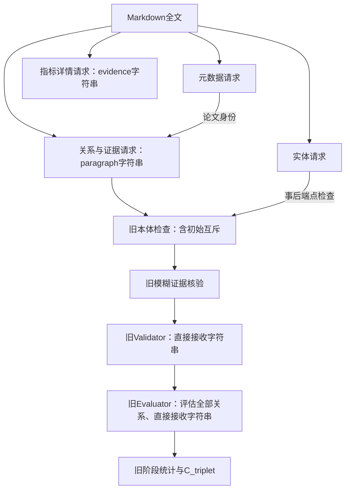

# 严格旧流程＋当前中文提示词

用户要求：除提示词外，其余计算流程全部对照 `cb2e962b1ab836f8ba1060c25895124f43dd1b57`，用于旧新流程对比。

## 入口如何保证一致

`experiments/migrated_baseline/run.py` 不再手工仿写旧抽取函数，也不调用当前验证器兼容分支；而是从本目录 `frozen/` 读取以下8个模块的提交原文，并逐文件验证 `manifest.json` 中的SHA256，在隔离的Python模块环境中直接执行：

- models.py：旧响应Schema。
- scientometrics_ontology.py：旧本体、端点、方向与初始互斥检查。
- evidence_validation_agent.py：旧模糊证据核验。
- local_formula_evidence.py：旧紧邻公式补全。
- validation_agent.py：旧Validator调用与解析。
- evaluation_agent.py：旧Evaluator调用与解析。
- triplet_metrics.py：旧阶段统计。
- extract_md_deepseek.py：旧四阶段抽取、验证及评估main原实现。

这些源文件没有修改。启动器只注入运行时工作区 `prompts_zh.py` 的当前中文提示词，并给详情提示词补充旧Schema所需的“evidence为字符串”说明。旧extract函数原有的实体清单措辞替换继续由原函数执行。共享工作区提示词不被改写，新流程也不受影响。

外层启动器负责新目录保护、源码／提示词快照、API请求日志和完成后的摘要副本，不改变旧流程的抽取、筛选或模型请求参数，不复用响应缓存。冻结文件已随基线目录保存，启动不再依赖Git提交对象；文件缺失、清单不符或哈希改变会直接报错，不静默改用最新代码。

## 实际计算流程



四次全文请求顺序为元数据→详情→实体→关系与证据；关系请求不消费实体清单或详情。

重要纠正：cb2e962原本已有variant_of／derived_from互斥，在本体检查阶段将同一有向对的竞争标签标为不合法，不依赖Validator是否通过。严格基线保留此原行为，不能误称原版没有互斥。它不执行当前方法的验证后冲突门控。

## 已撤销上一版兼容入口的变化

|项目|严格旧流程的行为|
|---|---|
|关系证据|只保留paragraph字符串，不新增evidence数组|
|指标详情evidence|恢复字符串，不是字符串数组|
|精确偏移标记|不新增evidence_exact_match、start、end等字段|
|证据核验|调用旧verify_evidence与旧模糊评分，默认阈值80|
|Validator|旧函数＋当前LEGACY_VALIDATION_PROMPT，启动器将其注入为VALIDATION_PROMPT，直接填入paragraph|
|Evaluator|旧函数＋当前EVALUATION_PROMPT，直接填入paragraph|
|多片段阅读附加说明|不注入，不调用multi_evidence_evaluation_prompt|
|本体及互斥|旧提交原逻辑，发生在Validator之前|
|验证后互斥门控|不执行|
|候选复核、检索、条件路径、选证、补检|均不执行|
|Evaluator筛选|不执行；保留规则仍为ontology_conformed AND evidence_validated AND valid|

最新提示词与旧Schema之间仅在提示词内说明字符串形式，不通过新数据结构替换旧计算流程。最新无证据候选提示词、证据角色提示词不属于旧流程的任务，故不调用。

2026-11-08：旧 Validator 使用用户提供的联合证据与辅助推理链验证提示词。旧流程没有生成或传入推理链，模板明确设置 `reasoning_chain` 为空，依据所给原文验证。专用模板位于 `extraction/prompts_zh.py` 的 `LEGACY_VALIDATION_PROMPT`；启动器注入后的模板照常保存到实验的 `injected_prompts.json` 并记录哈希。

2026-11-05提示词同步：旧关系任务 `KG_LINKING_PROMPT` 已加入与新候选任务逐字一致的“主动检查局限与对应能力”及“发现来源继承标签后仍须检查 improves_on”指令，并在任务开头显式提醒同一有向指标对的 variant_of／derived_from 互斥。两组原本就共享互斥关系定义；此次没有修改旧本体阶段的互斥实现。新流程的 `CANDIDATE_RELATIONS_PROMPT` 保持原样，关系与局部字符串证据联合输出等接口差异仍然存在。提示词版本已改变，后续实验请使用新输出目录，不能混入此前完成的50篇批次继续运行或回写历史结果。

## 命令

无API预检查：

```bash
.venv/bin/python extraction/experiments/migrated_baseline/run.py --check-only
```

应看到mode为“严格旧流程＋当前中文提示词”、两个证据Schema为字符串、evidence_array_wrapping=false，以及8个旧模块的源码哈希。

重新运行第一篇（需要新输出目录；本次未启动）：

```bash
.venv/bin/python extraction/experiments/migrated_baseline/run.py \
  --markdown '/Users/zengzizhao/Desktop/毕设论文/数据集md/2024/-index and its variants  a set of overall scholarly expertise diversity indices for the research portfolio management of institutions/full.md' \
  --output reports/migrated_baseline_strict_2026-11-05/paper_001_run1
```

支持旧入口的 model、validator-model、evaluator-model、base-url、thinking、max-tokens、threshold、date、paper-id 配置，默认值遵循旧入口。旧流程对照使用 `LEGACY_KG_LINKING_PROMPT`，关系证据取同一自然段内能独立支撑关系的最短连续原文，独立公式或表格限一个公式块或一行。启动器关闭旧紧邻公式补全，历史命令中的 `--no-local-formula-completion` 仍可传入。每次实验使用新输出目录。

## 输出及旧结果解释

- 原阶段结果：extracted_papers、ontology_conformed_papers、evidence_validated_papers、validated_papers、evaluated_papers，各按日期／paper-id保存。
- 原阶段表：reports/<date>/<paper-id>/table3.md。
- 顶层summary.json记录阶段表与最终文件的准确路径；final_graph.json只是完成后根据原标志生成的副本，证据保持字符串。
- base_commit_code保存8个逐字源文件；launcher_code保存启动器及当前提示词；api_calls记录实际请求响应，抽取消息中含实际使用的提示词与旧Schema。

现有 `reports/migrated_baseline_2026-11-04/paper_001_run1` 的12指标、15候选、13保留、13认可结果保持不变。该轮使用的是上一版“旧骨架＋数组封装＋当前验证后互斥”适配入口，不得改称严格旧流程结果，也不能通过删掉JSON字段将其追溯变成新实验。

正式对照需两组使用同一Markdown与模型，并冻结提示词版本、记录实际预算。这里是“旧计算流程＋最新提示词”与新方法的端到端对照，不是单模块消融；旧源码不等于旧提示词效果复现。

工程结构整理后，基线代码及清单集中在本目录；当前提示词仍从 `extraction/prompts_zh.py` 读取，配置仍为 `extraction/.env`。支持直接运行 `run.py` 或执行 `python -m extraction.experiments.migrated_baseline`。

## 验证

此前隔离版本的验证记录保留如下；本次工程整理后，当前测试位于 `extraction/tests/`，13项离线测试通过，另核对8份冻结源码与原提交逐字一致。测试覆盖旧请求顺序和上下文隔离、字符串Schema拒绝数组、原证据核验不新增结构、裁判收到当前基础模板及原字符串、初始互斥发生时点、Evaluator评估未保留候选。

另核验了旧模块正常退出、异常退出、部分加载失败时恢复当前模块，以及旧运行环境退出后新流程仍保持“元数据→实体→候选→详情”的顺序、实体清单约束及数组Schema。新流程12份核心文件与run4执行快照逐字一致，独立运行旧入口预检查前后，其源码及两轮历史汇总哈希均未变。没有修改新流程核心代码或调用API。

常规命令行分别启动新旧流程时，各自处于独立Python进程；旧代码的临时模块绑定只作用于旧进程。不要在同一Python解释器内多线程并发调用legacy_runtime和新流程，因为模块绑定替换不是线程隔离。两边共同读取当前提示词和服务配置，之后主动修改共享提示词会影响后续两组实验，应以保存快照固定比较版本。

## 批量运行一年目录下的论文

`batch.py`扫描input-root的直接子目录，每个 `<论文标题>/full.md` 运行一次。2026-11-05本地扫描2024目录得到291篇，缺失／空full.md及完全相同全文均未发现。每篇以相对路径哈希生成独立paper_id，不能使用共同文件名full作为全批唯一编号。

先只查看清单，不调用API、不创建输出目录：

```bash
.venv/bin/python extraction/experiments/migrated_baseline/batch.py \
  --input-root '/Users/zengzizhao/Desktop/毕设论文/数据集md/2024' \
  --output reports/migrated_baseline_strict_2026-11-05/2024_all \
  --dry-run
```

去掉 `--dry-run` 正式串行处理全部论文：

```bash
.venv/bin/python extraction/experiments/migrated_baseline/batch.py \
  --input-root '/Users/zengzizhao/Desktop/毕设论文/数据集md/2024' \
  --output reports/migrated_baseline_strict_2026-11-05/2024_all
```

如需先试跑3篇，增加 `--limit 3` 并改用独立的2024_smoke目录；全量批次不要使用这个试跑目录。

- 每篇启动独立Python子进程，调用本目录run.py，不改变旧算法或引入新方法模块。默认串行，不设置高并发。
- manifest.json记录输入路径、论文标题、全文哈希、固定模型与源码／提示词哈希。旧单篇开发实验不自动混入新批次，全量批次会重新处理包含第一篇在内的全部清单。
- 完成一篇立即更新batch_summary.json与report.md。各论文完整输出位于papers/<paper_id>/attempt_001/，日志位于同一论文目录下attempt_001.log。
- 中断后执行相同命令，跳过status和summary均完成的论文，再处理尚未开始项。不是在单篇内部恢复到某个模型请求；严格旧入口没有这种续跑行为。
- 失败或中断项默认保留，不自动反复发送。确认后可在相同命令末尾增加 `--retry-failed`，从头重试失败论文，写入attempt_002等新目录，保留原失败记录。始终跳过成功论文，不按C_triplet挑选较好的重复结果。
- 同一输出目录不允许并发启动两个批次。输入、模型、代码或提示词改变时拒绝混合续跑，改用新目录。批次运行期间也不要编辑共享源码或提示词。
- 例外仅限batch.py自身的调度／汇总修复：其余单篇实现、提示词、模型参数及论文清单必须保持一致，才能续跑；原manifest不回写，修改记录另存orchestrator_revisions.json，源码另存orchestrator_snapshots。不能据此放宽算法或提示词版本约束。
- report.md和batch_summary.json仅汇总已完成论文，C_triplet使用认可关系数／保留关系数的池化比例，不取论文百分比平均；失败不算作关系为假，也不计算人工召回率。存在未完成论文时，进度报告不是完整语料结果，程序结束返回非零状态。
- 运行期间终端显示开始／完成进度，完整模型日志保存在每篇log中。

本轮只进行了291篇扫描和4项批量调度离线测试；测试覆盖同名full.md编号、无副作用dry-run、已完成项跳过、输入变化拒绝续跑、池化统计和请求登记中断记录。没有由助手启动整批API实验。

后续修复：用户启动全量批次后第一篇已完成，原批量汇总错误地把summary中的table3.md当JSON读取。现按扩展名定位同目录table3.json；新增真实Markdown路径、缺失JSON和调度修复续跑边界测试，当前6项批量测试通过。已离线重建该批次进度为完成1篇、待处理290篇，第一篇结果与原manifest未改；未启动剩余论文。继续执行原批量命令即可跳过完成项。

## 先处理前50篇，后续在同目录扩展

使用新增的 `--stop-after 50`，保留完整291篇manifest，只限定本次调度范围。前N篇按论文文件夹名稳定排序，不是随机抽样；已完成论文计入前N篇，不会额外再运行N篇。

```bash
.venv/bin/python extraction/experiments/migrated_baseline/batch.py \
  --input-root '/Users/zengzizhao/Desktop/毕设论文/数据集md/2024' \
  --output reports/migrated_baseline_strict_2026-11-05/2024_all \
  --stop-after 50
```

当前第一篇已完成，使用相同输出目录会跳过它，只执行第2至第50篇中尚未开始的论文；失败项仍需显式retry-failed，不会自动重跑。

- 前50篇汇总：first_50_summary.json、first_50_report.md，包含本范围的阶段C_triplet及逐篇清单。
- 全批进度：batch_summary.json、report.md，仍反映完整291篇。
- 当前范围全部完成即正常结束；终端current_scope.complete及first_50_summary.json中的complete表示前50篇是否完成，顶层batch_summary.json中的complete仍表示完整291篇是否完成。
- 后续改为 `--stop-after 100` 会处理前100篇中未完成的论文；去掉参数则扩展至全清单。不改变原manifest，不重跑已成功论文。输入、模型、提示词和单篇代码仍必须相同。
- 原 `--limit` 会截断实验清单，只适合独立试跑目录，不支持在同目录扩展；它与stop-after不能同时使用。
- 参数必须为正整数；超过清单长度时处理全部已有论文。先加dry-run可查看本次计划。

当前8项批量测试通过，包含前1篇→前2篇→全清单扩展且只运行新增论文、重复范围不重跑、原manifest不变、限定范围完成时不因范围外待处理而报错，以及限制范围的dry-run无API副作用。未启动实际前50篇处理。
